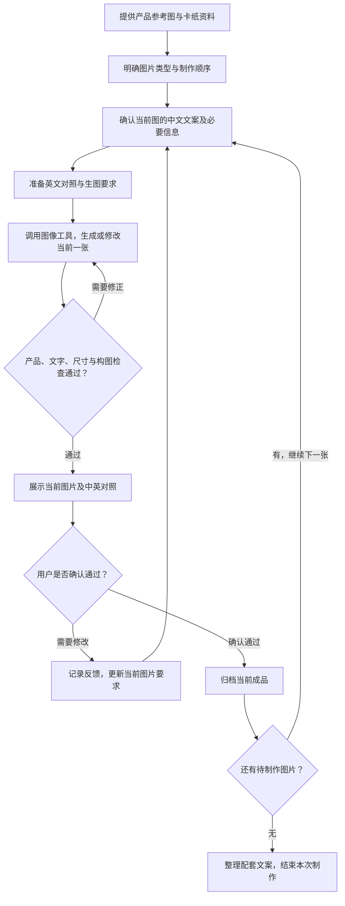

# Product Image Skills

商品图片制作技能库，收录用于电商商品图片与配套文案制作的 AI skills。

## 制作案例：致妻子心形项链

以下四张图片是用户使用 `tiktok-semi-managed-product-content` skill 制作并提供的成品，展示同一商品的首图、细节图、尺寸图和佩戴图。点击图片可查看完整 PNG。

| 首图 | 细节图 |
| :---: | :---: |
| [](examples/tiktok-semi-managed-product-content/致妻子心形项链/01-首图.png) | [](examples/tiktok-semi-managed-product-content/致妻子心形项链/02-细节图.png) |

| 尺寸图 | 佩戴图 |
| :---: | :---: |
| [](examples/tiktok-semi-managed-product-content/致妻子心形项链/03-尺寸图.png) | [](examples/tiktok-semi-managed-product-content/致妻子心形项链/04-佩戴图.png) |

[查看完整案例与图片说明](examples/tiktok-semi-managed-product-content/致妻子心形项链/README.md)

## 使用流程

### 1. 准备资料

- **产品参考图**：提供本次商品的清晰图片；有礼盒、卡纸或布局参考时，一并提供并说明用途。
- **卡纸内容**：提供本次使用的卡纸图片或清晰原文；卡纸文字按原文保留。
- **图片类型**：默认依次制作首图、细节图、尺寸图、佩戴图，也可以只选择其中几张。
- **真实尺寸**：制作尺寸图前提供数值、单位及测量对象；只制作其他图片时，可以先完成其他图片。
- **佩戴选择**：制作佩戴图前确认是否露脸；已经明确的信息直接沿用。

### 2. 逐张制作与确认



每次只处理当前一张图片。中文独立文案确认后，再提供英文与中文释义对照；没有独立文案的版本，说明本张不加独立文案即可。卡纸原文保持原语言及文字内容。

生成后先检查产品结构与颜色、卡纸文字、尺寸数字及构图；发现问题先修正，再展示给用户确认。用户提出修改时，沿用已经认可的部分；如果修改涉及文案含义，先重新确认中文意思。只有用户明确确认当前图片通过后，才归档并继续下一张。

### 3. Skill 与图像工具的分工

Skill 负责组织制作流程，约束产品还原、卡纸原文、尺寸标注、英文排版及逐张确认等要求。实际图片由运行环境中可用的 AI 图像生成与编辑工具完成，工具可以是环境提供的内置工具或支持接入的工具。使用时需要具备相应的图像工具能力。

### 4. 最后得到什么

- 本次选定的商品图片，按需制作并逐张确认。
- 图片独立文案的英文与中文释义对照。
- 配套商品名称候选，以及情绪标题和标签；情绪标题与标签先确认中文意思，再提供英文及中文释义对照。
- 经用户明确确认后归档的图片成品。

## 已收录的 skill

### TikTok 半托管商品图片与文案

[查看 skill 使用规则](skills/tiktok-semi-managed-product-content/SKILL.md)

根据产品参考图、卡纸内容及真实尺寸，逐张制作首图、细节图、尺寸图、佩戴图，以及配套情绪标题和标签。

- 默认采用竖版 3:4，保留产品真实结构与颜色。
- 先确认中文独立文案，再制作带英文文案的图片；卡纸原文逐字保留。
- 图片逐张生成、逐张确认；尺寸信息以用户提供的真实数据为准。
- 制作图片需要运行环境提供图像生成与编辑工具；本仓库本身不包含图像生成服务。

## 目录

```text
examples/
└── tiktok-semi-managed-product-content/
    └── 致妻子心形项链/        # 案例说明与四张成品图
skills/
└── tiktok-semi-managed-product-content/
    ├── SKILL.md
    └── agents/
        └── openai.yaml
```

后续可在 `skills/` 下新增其他商品图片制作 skill。
