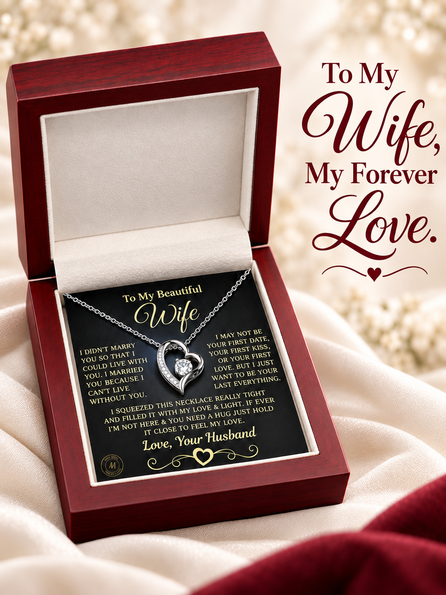
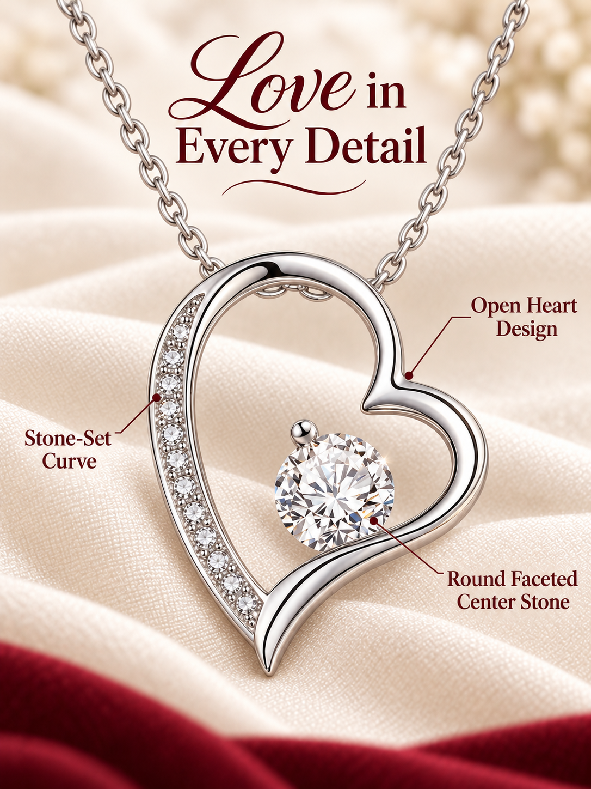
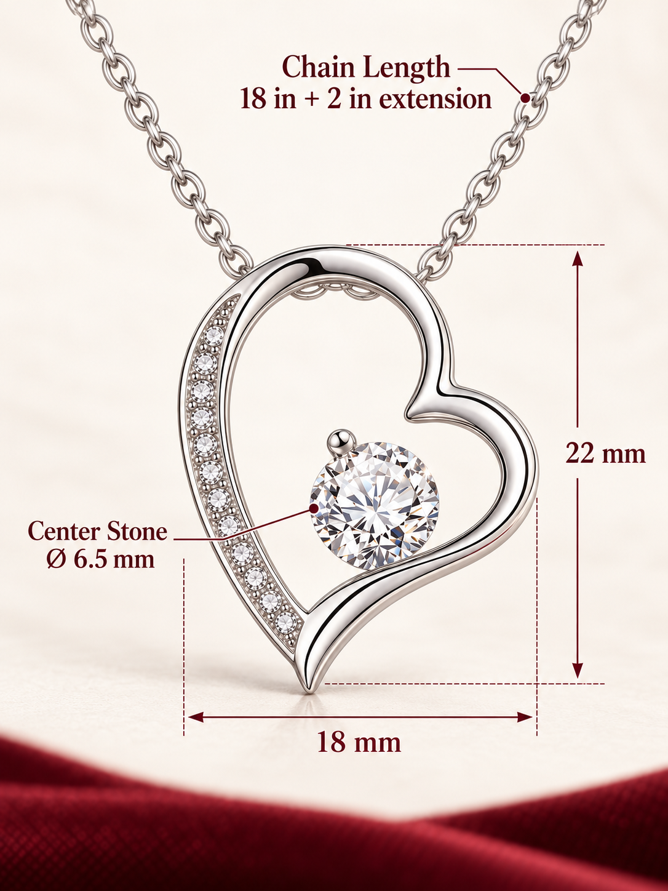
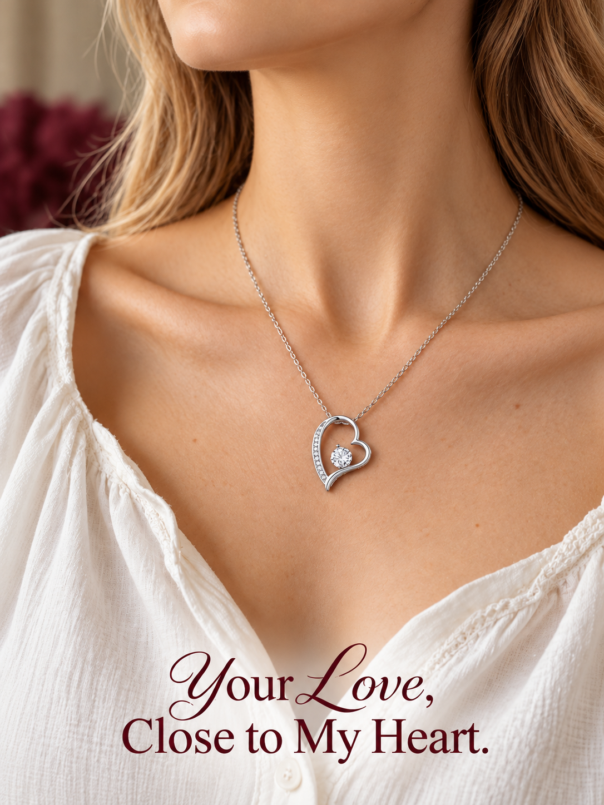

# 制作案例：致妻子心形项链

本案例收录用户使用 [TikTok 半托管商品图片与文案 skill](../../../skills/tiktok-semi-managed-product-content/SKILL.md) 制作并提供的最终四图，用于展示该 skill 的商品图片制作效果。

## 案例概况

- 商品：致妻子心形项链。
- 场景：伴侣赠礼主题的商品图片与英文情绪文案。
- 图片类型：首图、细节图、尺寸图、佩戴图。
- 画幅：竖版 3:4；每张图片实际像素为 1086 × 1448。
- 文件：保留用户提供的完整 PNG。

## 成品展示

| 首图 | 细节图 |
| :---: | :---: |
|  |  |

| 尺寸图 | 佩戴图 |
| :---: | :---: |
|  |  |

## 图片说明

| 文件 | 展示内容 |
| --- | --- |
| [01-首图.png](01-首图.png) | 礼盒、卡纸与项链的整体展示，配合致妻子的英文情绪标题。 |
| [02-细节图.png](02-细节图.png) | 心形吊坠局部特写，配合英文注释与引导线。 |
| [03-尺寸图.png](03-尺寸图.png) | 吊坠、中心石及链长的尺寸标注。 |
| [04-佩戴图.png](04-佩戴图.png) | 项链在颈部及胸前的佩戴展示，配合英文情绪文案。 |

[返回仓库首页](../../../README.md)
